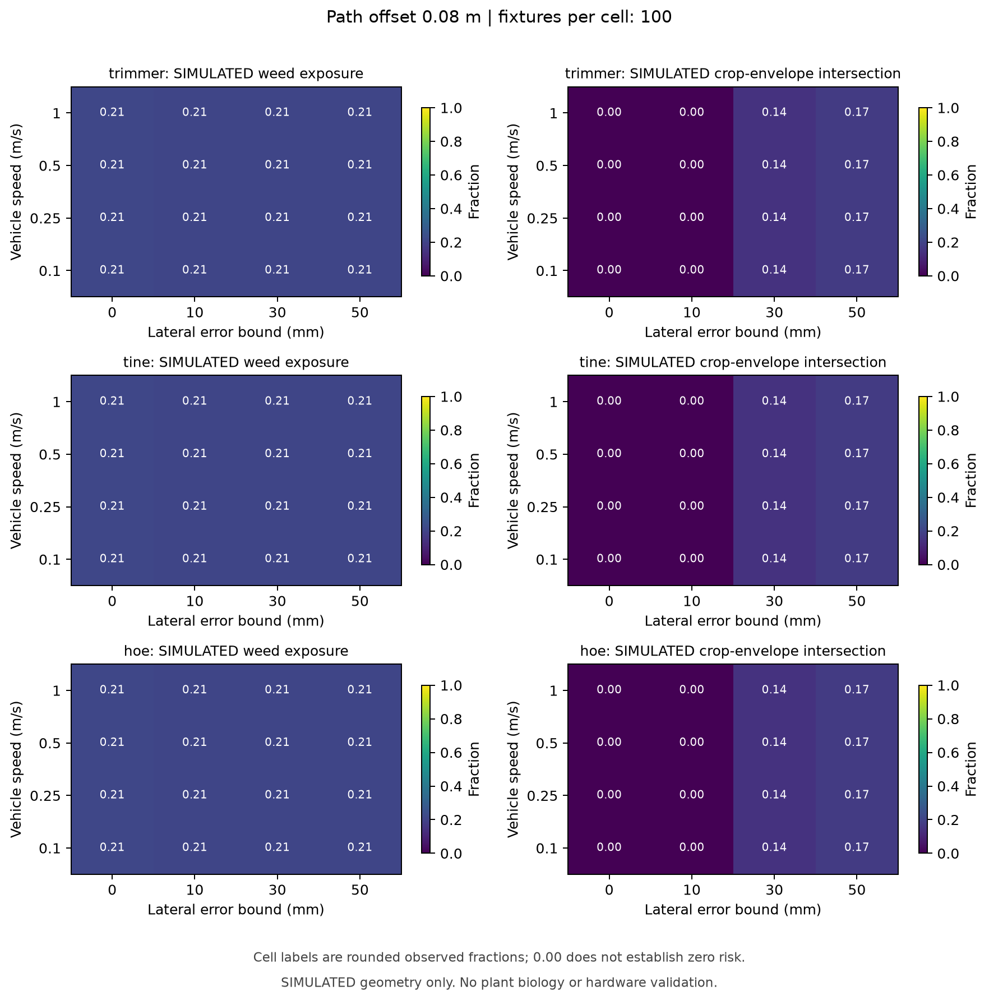
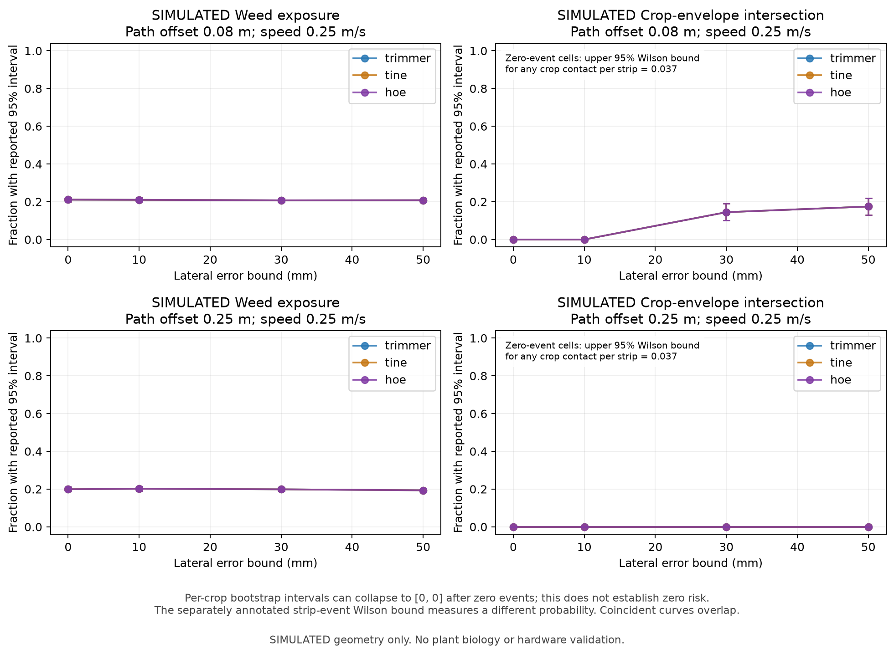
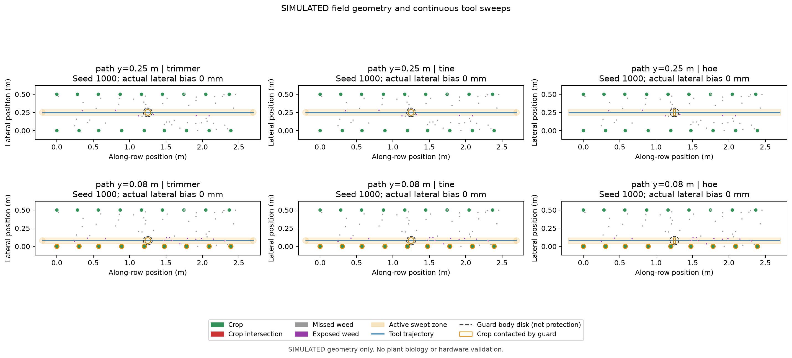

# Paired geometry comparison — pilot report

Pilot started 2026-09-14; final verification 2026-09-15. **SIMULATED geometry**, not weed removal, suppression, crop injury, soil response or hardware validation. This completes the paired-seed pilot and first comparison plots; it does not select a mechanism.

## Result and engineering decision

The tested fixed inter-row pass exposes approximately one fifth of the weeds in the entire declared 0.5 m wide target area. Moving the same 80 mm tool envelope close to the crop row increases crop intersections under lateral error. All three conservative mechanism envelopes give the same contact counts in this always-active, straight-pass experiment. There is no evidence here for choosing line, tine or hoe on biological efficacy, power, wear or cost.

At 0.25 m/s, all mechanisms give the following pooled rates. Other tested speeds give identical counts. Intervals are pointwise 95% whole-fixture percentile bootstrap intervals, with 500 resamples; they are approximate pilot estimates.

| Nominal path y | Uniform lateral bias bound | Weed exposure | Crop-envelope intersection | Crop interval |
|---|---:|---:|---:|---:|
| 250 mm, centred inter-row | 0 mm | 19.9% | 0% | Degenerate; no risk bound |
| 250 mm | ±10 mm | 20.2% | 0% | Degenerate; no risk bound |
| 250 mm | ±30 mm | 19.9% | 0% | Degenerate; no risk bound |
| 250 mm | ±50 mm | 19.4% | 0% | Degenerate; no risk bound |
| 80 mm, near-row | 0 mm | 21.1% | 0% | Degenerate; no risk bound |
| 80 mm | ±10 mm | 21.0% | 0% | Degenerate; no risk bound |
| 80 mm | ±30 mm | 20.7% | 14.5% | 10.0–18.9% |
| 80 mm | ±50 mm | 20.8% | 17.5% | 13.0–22.0% |

For the centred zero-error pass, weed exposure is 19.9% with a bootstrap interval of approximately 18.8–21.2%. A single 80 mm tool plus 10 mm weed radius on either side geometrically reaches a 100 mm band out of a 500 mm target width, so an approximately 20% exposure fraction is expected. This is a coverage constraint, not an estimate of poor cutting efficiency.

For the near-row ±30 mm case, 29 of 100 strips contain at least one crop intersection; the separate Wilson interval has an upper endpoint of 38.5%. For cells with zero crop intersections, the two-sided 95% Wilson upper endpoint for **any crop intersection in a strip** is still 3.70% (0/100), while the per-crop bootstrap collapses to [0,0]. These are different quantities. Neither establishes a <2% measured crop-damage rate.

The guard/body proxy also matters: at a nominal 80 mm path offset with no lateral error, it contacts 899 of 1,797 crop envelopes across the 100 strips, despite no active-cutter intersection. It is a solid 60 mm radius disk, not a modeled protective guard. Contact is not injury, but this footprint cannot be accepted as proof of passive crop protection.

Under these fixed dimensions and zero heading error, avoiding a cutter/stem contact for every bias in ±30 mm requires nominal offset **greater than 95 mm** (25 mm crop radius + 40 mm tool radius + 30 mm bias). The modeled body disk requires **greater than 115 mm**. Tangency is counted as contact, and these are geometric bounds only; compliance, sensing uncertainty, roots and real guard shape are unmodeled.

**Tech-lead decision:** retain all three concepts. Next compare multiple narrow-pass layouts and explicit passive guard shapes, deduplicating targets across passes and retaining crop-zone weeds in the denominator. Do not add retractors, vision or autonomy to compensate for this deliberately simple coverage experiment. Powered bench integration still requires the audit's ROS/HAL safety repairs.

## Plots







Additional [inter-row heatmaps](../simulation/experiments/comparison_pilot/heatmaps_offset_0.25.png) and SVG versions of each plot are in the output directory. Amber crop outlines identify guard/body contact. Example overlays use the first seed, first speed and zero-bias cell; they are illustrative fields, not representative uncertainty summaries. Coincident curves are expected here, not missing mechanisms.

## Experiment and statistical contract

- Source configuration: [comparison_pilot.yaml](../configs/comparison_pilot.yaml), based on the existing baseline with plant-spacing variance 0.0004 m² and weed density 40/m². All are synthetic design inputs.
- Independent samples: **100 two-row field strips**, seeds 1000–1099. Each strip is 2.5 m long, rows 0.5 m apart. The same stored plants are reused for every mechanism and sweep cell. The total crop count per cell is 1,797; denominators are not multiplied by the number of tested mechanisms or speeds when describing independent evidence.
- Grid: 3 mechanisms × 2 path offsets × 4 speeds (0.1, 0.25, 0.5, 1.0 m/s) × 4 lateral bounds (0, 10, 30, 50 mm) × 100 strips = **9,600 simulated passes**, 96 mechanism/cell summaries and 96 paired contrasts.
- Lateral error is one uniform signed bias per strip, held constant over a pass. The same underlying uniform variate is shared across mechanisms, bounds and speeds. This is not within-pass drift. Heading is zero; crop sensing and tool activation are ideal; the tool is continuously active throughout observed travel.
- The estimator is `sum(hits)/sum(targets)`, not the mean of strip percentages. Whole strips are resampled 500 times with seed 2026. Paired differences use identical strip indices for both arms and report A minus B. Zero denominators remain unavailable; excluded bootstrap draws and insufficient/degenerate distributions are explicitly labeled.
- The Wilson interval uses one Bernoulli observation per crop-bearing strip for the event “at least one crop intersection.” The number of eligible strips is exported. Plants from one strip are not treated as independent samples.
- All intervals are pointwise, not simultaneous across the grid. Reused seeds induce correlation across cells, deliberately improving paired comparisons. A shortlisted design requires confirmation with fresh seeds and later physical measurements. Bootstrap uncertainty describes Monte Carlo sampling under stated assumptions; it does not include model error.
- Identical line/tine disks must match exactly. In this experiment the hoe also has the same lateral span and traverses the entire observation area, so its distinct longitudinal footprint changes contact timing but not which plants are contacted. Likewise, speed cannot change geometric counts without timing/phase/path changes; the speed-invariance tests enforce that fact.

## Reproduce and inspect

The completed run used Python 3.11 in a repository-local virtual environment. Exact plotting dependencies are in [requirements-geometry.txt](../requirements-geometry.txt). No global Python environment was modified.

```powershell
python -m venv .venv-geometry
.\.venv-geometry\Scripts\python.exe -m pip install -r requirements-geometry.txt
$env:MPLCONFIGDIR = Join-Path (Get-Location) '.mpl-cache'
.\.venv-geometry\Scripts\python.exe -m unittest discover -s tests -v
.\.venv-geometry\Scripts\python.exe -m simulation.monte_carlo --config configs/comparison_pilot.yaml --output simulation/experiments/comparison_pilot
```

On Linux use `.venv-geometry/bin/python` and set `MPLCONFIGDIR` with the shell's environment syntax. `--no-plots` runs the numerical experiment without Matplotlib/NumPy; a JSON plan and JSON base configuration also avoid PyYAML. YAML/JSON duplicate and unknown configuration keys are rejected. The numerical implementation uses the standard library and reuses the tested geometry kernel with trajectory sampling omitted for batch runs; exact event calculations are unchanged.

| Artifact | Purpose |
|---|---|
| [metadata.json](../simulation/experiments/comparison_pilot/metadata.json) | Plan, base configuration, independent sample count, environment versions, source and data hashes |
| [fields.json](../simulation/experiments/comparison_pilot/fields.json) | Every generated plant, its ID and field seed; permits exact field replay |
| [rows.csv](../simulation/experiments/comparison_pilot/rows.csv) | Per-pass counts, fractions, actual bias, field/config hash and evidence class |
| [events.csv](../simulation/experiments/comparison_pilot/events.csv) | All active and guard contact intervals with mechanism, cell, seed and entity IDs |
| [aggregates.csv](../simulation/experiments/comparison_pilot/aggregates.csv) | Pooled rates, denominators, uncertainty bounds and limitations |
| [paired_differences.csv](../simulation/experiments/comparison_pilot/paired_differences.csv) | A-minus-B contrasts with paired-bootstrap bounds |
| `examples/` | Full trajectory and event exports for each plotted example |

Re-running replaces the named artifacts; use a new directory to retain another experiment. Geometry outputs are deterministic for the same configuration, fields and source; plotting serialization may include renderer metadata. Source hashes identify the implementation but do not archive it. The earlier single-pass baseline remains a historical artifact with its original source fingerprint.

QA: **49 tests passed**, covering the existing geometry/export suite plus pooled-rate arithmetic, paired resampling, Wilson boundaries, missing/degenerate uncertainty, input validation, equal disk envelopes, speed invariance, field identity, replay and source/artifact hashes. These tests do not validate ROS control, emergency stop, electrical hardware or biological outcomes. The four PNG figures were also visually reviewed for labels and clipping.
