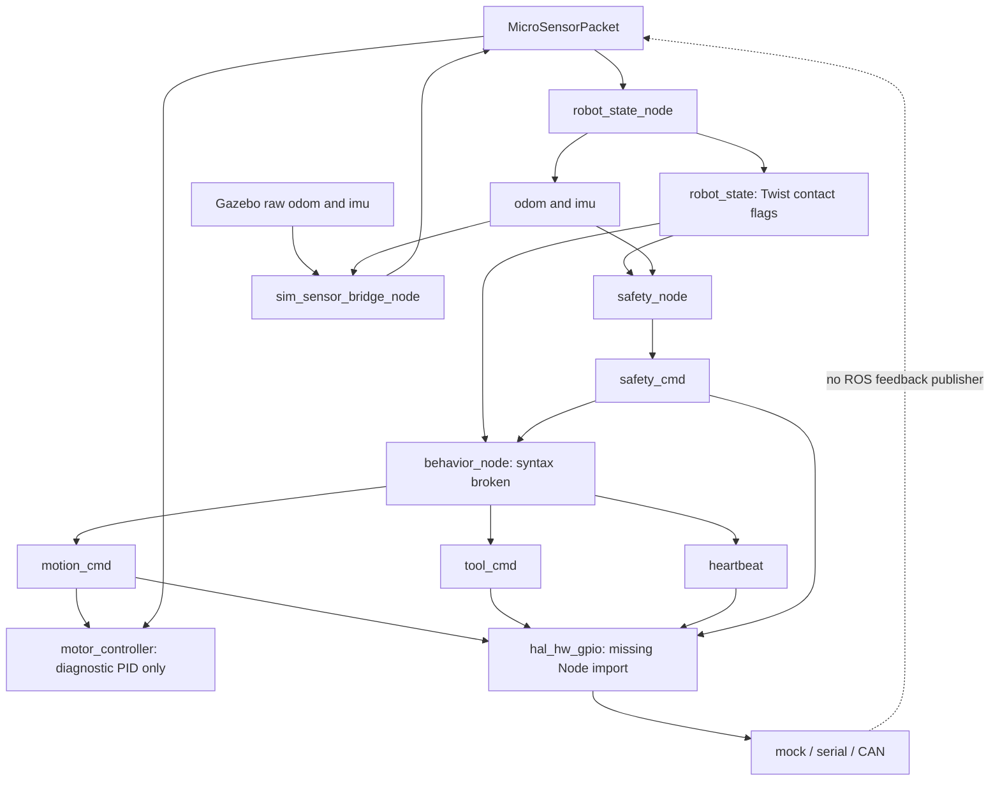

# Current-state audit — Phase 0

Mock launch verification update (2026-10-20): both ROS packages built; installed mock acceptance passed 3 tests/19 checkpoints; regression passed 205 tests with zero skips. Fixed generated-IMU boolean validation and duplicate ROS shutdown calls. Package lint remains failing (2 failures, 1 existing skip). See [full results and limits](ros2_mock_launch_acceptance.md). No powered-test or feature-freeze gate is lifted.

ROS verification update (2026-10-19): the previously skipped HAL ROS/DDS test passed in Ubuntu WSL with Jazzy; the complete existing suite passed **204/204 with zero skips**. See [runtime evidence and remaining scope](ros2_wsl_validation.md). This does not release powered tests or change the current problem-validation/feature-freeze decisions. Earlier runtime-skip statements below are historical.

Audit date: 2026-09-14. Baseline: local `main` at `bcb7800` (`origin/main` points to the same commit). Scope is repository inspection, practical validation and a proposed pivot, **not implementation**. Existing source, worlds, interfaces and frozen experiments have not been changed. This document supersedes the READMEs' unverified “production-ready”, “hardware ready” and “safety verified” claims for this checkout.

## Decision

Useful R&D assets exist, but no complete control or simulation path has been demonstrated working in this environment. Preserve them incrementally. Start mechanism validation with a standalone, deterministic geometry experiment; repair safety before connecting any powered bench. Do not make autonomy or vision a prerequisite.

Supporting reviews: [robotics and QA](robotics_audit_notes.md), [simulation and vision](simulation_audit_notes.md), [mechanical concepts and evaluation](mechanism_concept_notes.md). A [file inventory](repository_inventory.md) records the inspected working-tree assets. The proposed interfaces, experiment and ordered backlog are in [pivot architecture](pivot_architecture.md).

## Repository and branch inspection

- Initial working tree was clean. No `AGENTS.md` was found under the repository. Git's ownership check required a command-scoped `-c safe.directory=C:/Users/rosha/OneDrive/Documents/Deweeder`; no global configuration was changed.
- Local branch: `main`. Cached remote branches: `Gazebo_Simulation`, `Gazebo_Simulation_v1`, `Milestone-3`, `Milestone4`, `main`, `milestone2`, `milestone3.1`, `milestone4_patch`, `revert-7-milestone2`, `shortintegationsandHAL`, `weed_removal` (plus symbolic `origin/HEAD`). No network fetch or branch switching was performed; remote freshness is unknown.
- `git log --all --not main --oneline` shows only `f88ffc1 Revert "Milestone 2"` outside main's ancestry. Most named experimental histories are already ancestors of main; branch names are not evidence of clean alternative implementations.
- `git ls-files -u` is empty: no active unresolved Git index entries. Nevertheless, committed conflict text remains in two source assets. `git diff --check` initially passed because those defects are already committed.
- Inspected both READMEs, package/build metadata, Python source and tests, scripts, message definitions, YAML, robot/world/PROTO text, notebook JSON, and saved patch. Binary images/PDFs were inventoried; reference-paper contents and historical graph screenshots were not validated as current architecture. No local PDF parser was available. No paper results are used as evidence here.

## Component inventory and disposition

Disposition describes future treatment, not changes already made. KEEP means useful after appropriate verification; FREEZE means preserve without active feature development. REMOVE below is a candidate only; nothing was deleted.

| Component / location | Domain and observed purpose | Disposition |
|---|---|---|
| `deweeder_tertill/src/weedbot_msgs` | ROS2 ament/CMake package; four custom messages | KEEP intent; REFACTOR metadata and document units/freshness compatibly |
| `deweeder_tertill/src/weedbot_core` | ROS2 ament/Python package; state, behavior, safety, PID, HAL, simulation bridge, planner/logger | REFACTOR packaging and broken paths; keep small functional boundaries |
| `robot_state_node.py` | Sensing and mobility: encoder pose, IMU forwarding, contact flags | KEEP integration approach; REFACTOR velocity calculation, constants and typed state |
| `motor_controller.py` | Mobility: PID utility and diagnostics | KEEP PID candidate; REFACTOR before calling it closed-loop control |
| `hal/driver_interface.py`, `drivers/mock_driver.py` | Hardware abstraction and test seam | KEEP; extend explicit tool contract and recording fault tests |
| `drivers/serial_driver.py`, `socketcan_driver.py` | Transport framing and cached feedback | KEEP prototypes; UNKNOWN MCU/protocol/hardware validation |
| `hal_hw_gpio.py`, `hal_node.py` | Alternative HAL implementations, direct commands and safety gating | REFACTOR to one selected command authority; retain legacy version until replacement tested |
| `safety_node.py`, watchdog/heartbeat infrastructure | Safety state and intended stop behavior | KEEP intent; REFACTOR immediate stop, deadlines, health and rearm semantics |
| `behavior_node.py` | Contact-driven mobility/tool behavior and planner heading | REFACTOR syntax/safety; FREEZE weed-hunting/navigation extensions |
| `coverage_planner_node.py` | Coverage/heading generation | FREEZE; no bench dependency |
| `data_logger_node.py`, `rosgraph_stage*.png` | Logging and historical architecture images | KEEP logging candidate; UNKNOWN image currency and KPI adequacy |
| `launch/`, `scripts/`, `cmd.yaml` | ROS launch, bridges, manual publishers, smoke tests, example command | REFACTOR installation, topic ownership and trustworthy test exits |
| `deweeder_tertill/models/weedbot/model.sdf` | Gazebo mobile body and visual trimmer | KEEP reference geometry; UNKNOWN mechanical fidelity |
| `src/weedbot_simulation_tertill` | ROS2 ament/CMake package; Tertill URDF, Gazebo world and launch | REFACTOR XML/conflicts if reused; FREEZE rover expansion |
| `src/deweeder_robot` | ROS2 ament/Python package; detector, arm, Gazebo URDF/worlds | FREEZE vision/arm direction; record packaging/simulator defects |
| `controllers/my_controller/my_controller.py` | Webots HSV detector, driving and arm state machine | FREEZE historical autonomous demo; REFACTOR only if needed for later visualization |
| `worlds/Farm of Deweeder.wbt`, `protos/RectangleArena.proto`, icon | Webots field, robot/arm and arena assets | KEEP visual references; do not use as validated collision/soil model |
| `Deweeder_Yolov8.ipynb`, `deweeer_yolo_training.py` | Experimental YOLO training, notebook/Colab workflow | FREEZE both; no model training or large perception dependencies |
| `start_simulation.sh` | Linux desktop multi-terminal Gazebo launcher | FREEZE as historical procedure; REFACTOR reproducibility if resurrected |
| `deweeder_tertill/tests/test_hal_mock.py`, core `test/` | One mock unit test plus three ament lint tests | KEEP; REFACTOR missing behavioral/safety coverage |
| Two root research PDFs | Reference literature | UNKNOWN applicability; preserve, no experimental conclusions inferred |
| `deweeder_tertill/patch.patch` | Saved proposed edits, including missing Node import | KEEP provenance; do not blindly apply partially incorporated patch |
| `crop_field.world`, `crop_field_utf8.world` | Parallel crop worlds, only selected path used by launcher | UNKNOWN need for both; candidate REMOVE redundant copy after reference/content review |
| READMEs, `.gitignore`, `.vscode/settings.json` | Historical instructions, generated-file exclusions, local CMake target | KEEP history; REFACTOR README claims/entry instructions in follow-up; local IDE setting is not build configuration |
| CAD/BOM/bench measurements/evaluation datasets | No manufacturing CAD, STEP/STL, bench drawings, crop profiles or measured outcomes found | UNKNOWN physical design; proposed new work, not a hidden completed mechanism |

All four `package.xml` files parse as XML. This does not establish valid ROS dependency or interface generation metadata. Existing distro declarations are Jazzy; no migration to Humble is justified by this audit.

## Architecture as implemented

The diagram represents static connections and gaps, not a successfully launched graph. The Gazebo raw/reconstructed topic names overlap, forming feedback through the sensor bridge. A separate motion bridge script converts commands to `cmd_vel` but is not included in full simulation launch and bypasses HAL safety. The root Webots demo runs independently of this graph; no working ROS2-Webots integration was demonstrated. Root `deweeder_robot` is another camera-to-target-to-arm path, not the Tertill HAL chain.

Interface inventory:

| Interface | Current payload | Gap |
|---|---|---|
| `MicroSensorPacket` | Four int32 encoders, five contact flags, acceleration/angular arrays, six currents, tick_time | No header, validity/sequence contract; units, tick semantics and wheel ordering need enforcement |
| `MotionCmd` | linear_x, angular_z | No expiry or arbitration identity; preserve compatibility with a future adapter |
| `ToolCmd` | front_trimmer_on, belly_trimmer_mode, agitator_pulse | No feedback, acknowledgement, tool identity or coast-down state; drivers do not implement tool action |
| `SafetyCmd` | uint8 state | Node constants 0–3 exist, but no message enums, reason, expiry or latched reset contract |
| `/robot_state` | geometry_msgs/Twist repurposed for contact bits | Must not be interpreted as measured velocity; rear contact is dropped |

## Validation performed and practical limits

Host: Windows PowerShell; working `python` is 3.11.15 from an existing external virtual environment. Nothing was installed there. `rg` could not execute, so file enumeration and text scanning used PowerShell/Python.

| Check / command | Result | Meaning |
|---|---|---|
| AST parse all 34 repository `.py` files | 32 parse, 2 fail | Behavior fails at line 122 after empty definition at 121; training export fails at line 1. Parsing is not runtime correctness |
| XML parse four manifests, two URDFs, one SDF, four `.world` files | 9 pass, 2 fail | `weedbot.urdf:292` conflict text; `weedbot.world:107` mismatched tag. Not a URDF/SDF semantic validator |
| Conflict scan over decodable working-tree files | Nine delimiter lines in two files | Behavior lines 162/208/209/216/217/250; Tertill URDF 292/305/306 |
| Notebook JSON load | PASS, 11 cells | Training was not executed; no accuracy validation |
| Direct MockDriver init/PWM/encoder/current/stop/shutdown assertions | PASS | Repeated the existing unit-test operations without pytest and additionally checked stored PWM zero after stop. Pure software mock only |
| `python -m pytest deweeder_tertill/tests deweeder_tertill/src/weedbot_core/test -q -p no:cacheprovider` with core on PYTHONPATH | BLOCKED: no pytest | No pytest pass claimed; ament dependencies also unavailable |
| README `python -m pip install -r requirements.txt` | BLOCKED: no pip; requirements.txt also absent | No dependencies installed; documented setup cannot be followed as written |
| README `colcon build --symlink-install` | BLOCKED: command unavailable | ROS build not performed; same missing tool blocks nested-workspace build |
| ROS launch and colcon test | BLOCKED: ros2/colcon and rclpy unavailable | No ROS node, interface-generation, launch or integration pass |
| Webots and Gazebo launch | NOT RUN: simulator executables absent from PATH, controller API absent | Root script also assumes `/opt/ros/jazzy`, `~/deweeder_ws` and gnome-terminal; no desktop processes launched |
| Alternate `py -3.12` | BLOCKED: registered executable cannot be launched | Not used to claim dependency availability |
| Numeric/CAD libraries | NumPy/pandas/matplotlib/CadQuery absent in working interpreter | No Monte Carlo, plots or CAD attempted in Phase 0 |

No hardware smoke/ramp scripts were run. Existing scripts publish commands and need a verified mock-only fixture before execution. No WSL provisioning, distro migration or dependency installation was needed to establish the static findings.

## Broken code and incomplete behavior

Priority is consequence, not file order. Detailed paths/lines appear in the supporting notes.

1. **Safety-critical design gaps:** HAL only checks stale heartbeat when another command arrives; STOP callback stores state without stopping retained output. No independent expiry stop or backend emergency-stop invocation. Belly tool mode is not neutralized with front-tool gating. Safety starts NORMAL, lacks sensor expiry and latched rearm, and checks angular rate rather than static tilt. These source findings do not prove any physical actuator is connected, but prevent hardware-readiness claims.
2. **Startup/build blockers:** behavior has an empty callback and conflict markers; HAL lacks `Node` import; core packaging excludes driver/HAL subpackages and some launch/YAML files. Root detector/arm entry points do not match actual modules. Tertill URDF and world are malformed.
3. **Control incoherence:** PID output is text only while HAL separately scales commands open-loop. Encoder grouping differs between nodes; PID uses counts as speed; state-node velocity uses already-updated counts and becomes zero. Model radii/tracks are inconsistent. Hardware sensor caches never reach `MicroSensorPacket`.
4. **Simulation errors:** duplicate raw/estimated topics feed back; missing gated `motion_cmd` to simulator path; root Gazebo launcher uses a world name that disagrees with the file. Classic-plugin URDF and `gz sim` paths are mixed. Webots robot and arm are separate robots sharing a controller that expects both sets of devices; state timers can stall arm transitions. Its visual crops/weeds do not establish collision physics.
5. **Validation/documentation gaps:** safety scripts inspect text or print FAIL without reliably failing, and can start duplicate nodes. Only one mock behavioral test exists; copyright test is marked skipped. Missing setup files and stale hardware-ready statements obscure actual status. The Python training export contains notebook syntax and remains frozen.

TODO/FIXME scan found placeholder description/license/maintainer entries in core, root robot and simulation manifests/setup metadata; no comprehensive implementation TODO ledger exists. Unfinished behavior is more extensive than explicit TODOs. Duplicate candidates include two HALs, parallel robot models, motion publishers/bridges, two crop worlds, and the saved patch. Their intentions differ; deleting them during audit would lose useful history.

## Top five technical risks

| Rank | Risk | Evidence / next risk-reduction gate |
|---|---|---|
| 1 | Tool or mobility remains active after stop, stale command or communication loss | Source watchdog/interlock gaps; recording-mock tests must prove final outputs neutralize without new callbacks |
| 2 | Geometric crop clearance is mistaken for low crop damage | No measured suppression, roots, guard compliance, coast-down or crop injury data; use separate proxy names and later bench follow-up |
| 3 | Fixed geometry protects crops by leaving too many weeds untreated | No target-denominator or clearance study exists; paired-seed near-row/inter-row sweeps with all weeds retained in denominator |
| 4 | Position/timing errors invalidate precision claims | Encoder units/order/velocity bugs, model scale disagreement and unknown delay; deterministic analytic cases and measured calibration |
| 5 | Apparent software success does not reproduce as an installed system | Committed conflicts, packaging omissions, incompatible launch assumptions and weak smoke tests; clean Jazzy build/install/mock launch with actual assertions |

## Team disposition and next decision

Logical roles were maintained across the audit: root served system architect/tech lead and integrated QA evidence; robotics reviewer covered ROS/HAL/safety; simulation reviewer covered Webots/Gazebo/vision; mechanical reviewer covered concepts and evaluation. Their notes remain reviewable. Tech-lead challenges: PID diagnostics are not motor control; guard contact is not proven crop safety; A/B disk envelopes can give identical geometry results despite different biological outcomes; a weighted score cannot select a mechanism before measurements.

Phase 0 deliverables are complete with the runtime limitations above. No significant architecture was modified. **First experiment:** deterministic and then randomized swept-tool clearance/exposure on a 2.5 m synthetic row, including ±30 mm drift and actuator delays. **Next implementation task:** create the independent geometry configuration/validation and deterministic event kernel described in the pivot document, with safety repair as a separate highest-priority gate before powered integration. Do not start Phase 1 inside this audit change.
