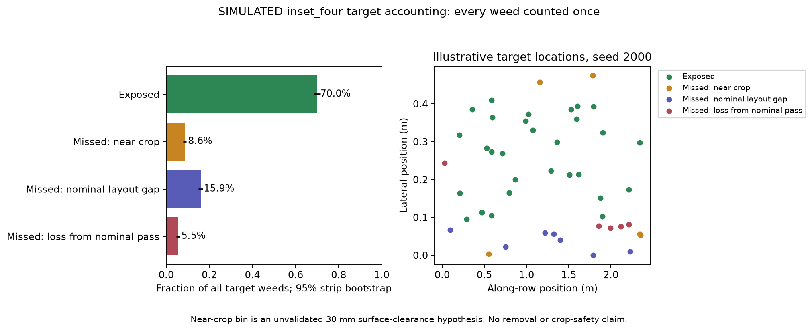

# Accounting for the four-pass misses

2026-09-15. **SIMULATED** diagnostic analysis of the recorded inset-four / U-frame / independent ±30 mm error cell. The same 100 strips, 1,790 crops and 5,071 weeds from the multi-pass pilot are reused; this is not a new independent experiment.

| Outcome | Targets | Fraction of all weeds | Pointwise 95% strip-bootstrap interval |
|---|---:|---:|---:|
| Exposed at least once | 3,549 | 70.0% | 68.4–71.5% |
| Missed and near a crop | 435 | 8.6% | 7.8–9.4% |
| Missed by the nominal fixed-pass layout, outside that near-crop bin | 808 | 15.9% | 14.9–16.9% |
| Missed despite being reachable by ideal nominal passes | 279 | 5.5% | 4.6–6.4% |

The partition sums to every original target. It does not discard weeds near crops or double-count overlapping passes. The 1,522 misses comprise approximately 29% near-crop misses, 53% nominal-layout gaps and 18% lost nominal exposure.

“Near crop” means the nearest **weed-to-crop disk surface clearance is at most 30 mm**, including overlapping disks. It is an unvalidated diagnostic threshold, not a safe operating distance. Distance is to individual plants, not merely to the row centreline. A weed between widely spaced crops can be outside this bin even if it is near the row line.

Classification precedence is: exposed first; otherwise near-crop miss; otherwise a nominal-layout gap or loss from nominal exposure. There are also 37 exposed weeds within the diagnostic near-crop threshold. A blanket ban on that threshold would therefore exclude 472 targets (9.3%), not just the 435 currently missed. No biological result follows from either number.

The ideal reference uses the same field, tool width and four pass offsets, with zero lateral/heading errors and continuous activation. It exposes 3,618 weeds. Actual passes lose 279 of those opportunities but gain 210 outside the nominal footprint, yielding 3,549 exposures: **3,618 − 279 + 210 = 3,549**. Thus 5.5% is gross lost nominal exposure, not the net effect of path error. This distinction matters when assessing a guide: tighter tracking must be evaluated over the complete operation rather than assuming every currently missed weed becomes an additional success.



## Engineering consequence

The largest missed group is outside the nominal pass footprint and outside the diagnostic near-crop bin. Perfectly repeating the current four offsets cannot recover those weeds. Conversely, simply moving to the previously tested five-pass layout causes extensive crop/body intersections. This supports a bounded next mechanical experiment: measure repeatability and contact geometry of a guided, unpowered carriage, and investigate access between individual crop positions before adding powered or autonomous behavior.

The [unpowered guide/guard bench specification](unpowered_guard_bench.md) and [parameter file](../configs/unpowered_guard_bench.yaml) define surrogate crop geometry, dummy-tool dimensions, offset tests, logging and acceptance hypotheses. Mount-interface dimensions, vertical clearance and material compliance remain unverified. No physical construction, purchasing, powered testing or manufacturing CAD was performed.

## Implementation and replay

[misses.py](../simulation/geometry/misses.py) classifies targets from plant geometry and the union of active events. Guard-only events never count as weed exposure. It validates population IDs and event references, retains empty-denominator semantics, and uses deterministic ID ordering. The `path_error` category means loss relative to the specified ideal reference; for other experiments with timing or heading differences it must not be interpreted as an isolated causal estimate of lateral tracking error.

[miss_analysis.py](../simulation/monte_carlo/miss_analysis.py) verifies the saved input artifact hashes, selects one complete operation cell, checks its recomputed exposure counts against recorded rows, and bootstraps whole strips for each category. New model fitting and synthetic field generation are not involved. Marginal category intervals are pointwise and need not sum to one at their endpoints.

```powershell
$env:MPLCONFIGDIR = Join-Path (Get-Location) '.mpl-cache'
.\.venv-geometry\Scripts\python.exe -m simulation.monte_carlo.miss_analysis --input simulation/experiments/multipass_pilot --output simulation/experiments/miss_analysis
```

Detailed inputs are locally retained but ignored by Git. On a fresh checkout first run the multi-pass command in [the experiment-artifact guide](../simulation/experiments/README.md). The new command writes `summary.json`, `targets.csv`, `fixtures.csv` and `miss_breakdown.png`; Git retains the summary and preview. Select another cell with `--layout`, `--guard`, `--mode` and `--bound`, or change the diagnostic threshold with `--clearance`. `--no-plots` avoids plotting dependencies.

[Saved summary](../simulation/experiments/miss_analysis/summary.json) includes input metadata and classifier source hashes, category counts, uncertainty and the gross gain/loss comparison. Source fingerprints identify a run, not an archive of changing source files.

QA: **73 tests passed**, including six new tests for partition precedence, event union, guard-only events, signed surface clearance and threshold inclusion, deterministic nearest-crop ties, empty/invalid populations, saved-operation replay and detection of tampered input artifacts. This does not validate measured crop damage, weed suppression, powered stopping or the as-built bench.
