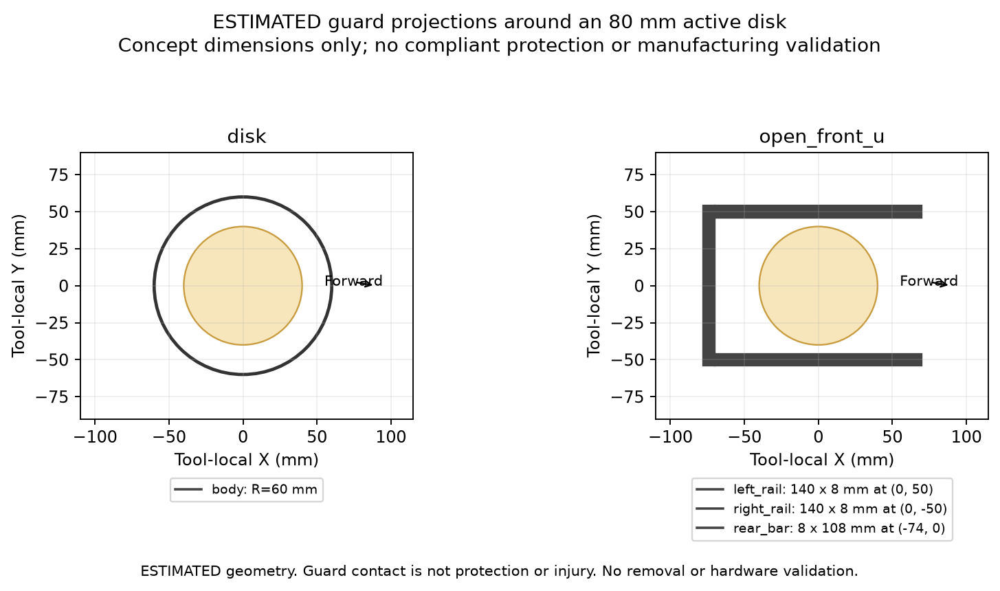
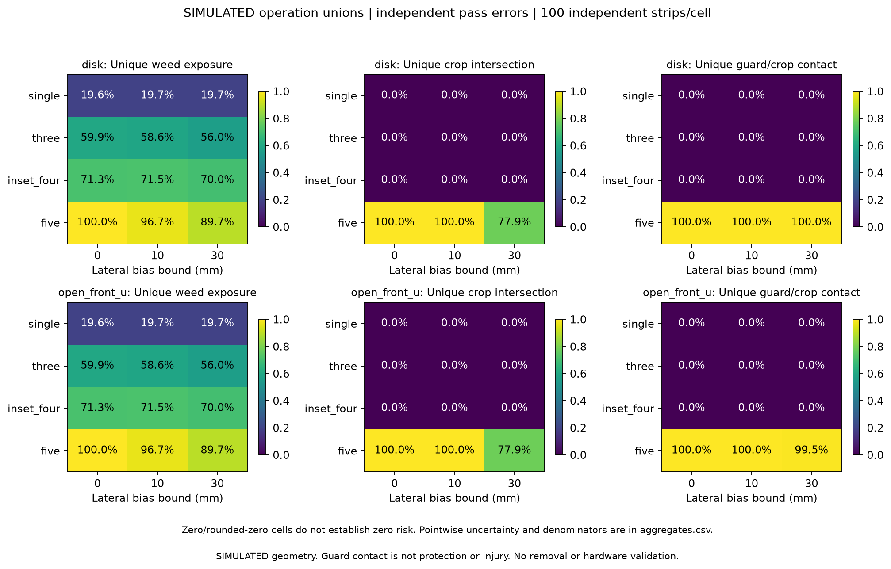
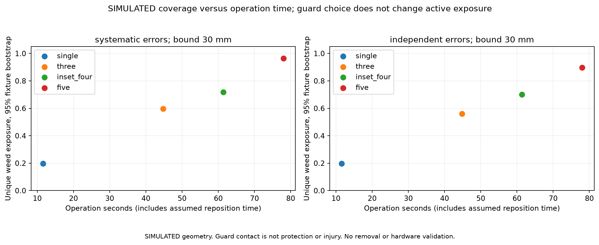
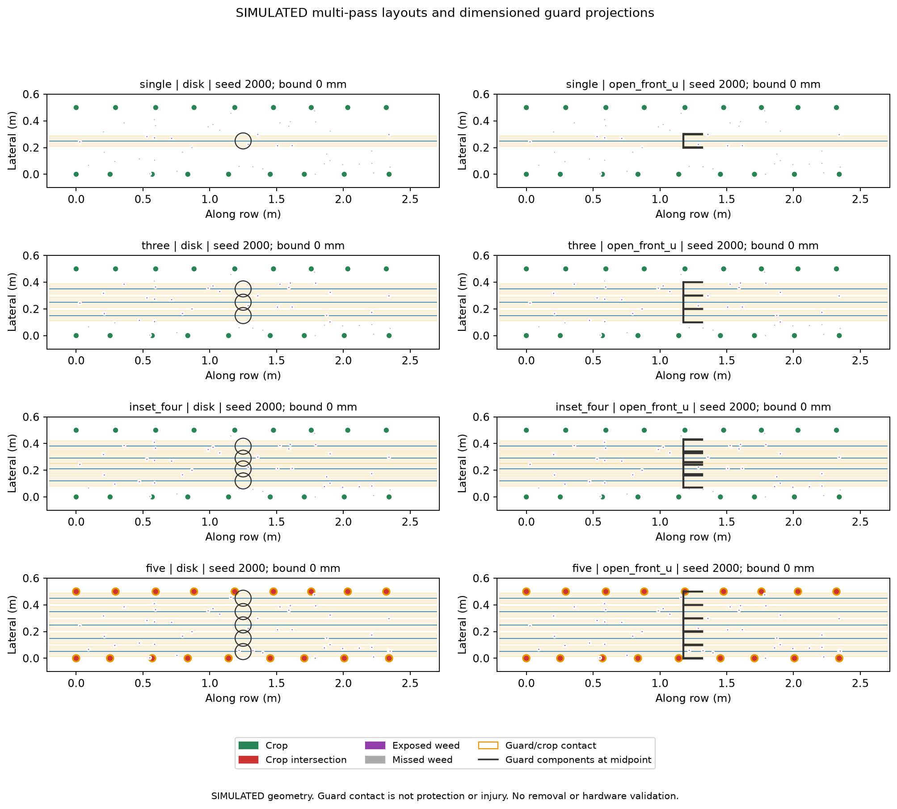

# Multiple passes and explicit guard geometry

2026-09-15. **SIMULATED** operation-level geometry. The guard dimensions are **ESTIMATED** design inputs, not measured protective performance. No crop injury, weed removal, suppression, soil response or hardware safety has been tested.

## Decision

Multiple narrow passes improve geometric weed exposure, but the tested layouts do not simultaneously achieve the project's exposure and crop-clearance hypotheses. The inset four-pass layout avoids projected crop/body contacts in the sampled cases while leaving approximately 30% of targets unexposed. The five-pass layout reaches the crop rows and is rejected as a candidate for powered testing in its present form: most crop envelopes intersect its active tool and nearly all intersect its guard/body projection.

Do not select the U-shaped guard as a proven protection mechanism. In this evaluator a guard can contact a plant, but it cannot deflect it, change the tool path or inhibit cutting. Replacing a solid disk with separate rails therefore cannot automatically make near-crop treatment safe.

## Results

Each rate below uses unique plants across the entire operation. Results use the explicit U-frame and 100 independent strips. The active-tool results are identical for both guard geometries by design.

| Layout / lateral offsets from first row | Passes | Zero-error exposure | Exposure under independent ±30 mm errors | Crop intersections under those errors | Simulated operation time |
|---|---:|---:|---:|---:|---:|
| Single: 250 mm | 1 | 19.6% | 19.7% | 0 observed | 11.6 s |
| Three: 150, 250, 350 mm | 3 | 59.9% | 56.0% | 0 observed | 44.8 s |
| Inset four: 120, 210, 290, 380 mm | 4 | 71.3% | 70.0% | 0 observed | 61.4 s |
| Five: 50, 150, 250, 350, 450 mm | 5 | 100% | 89.7% | 77.9% | 78.0 s |

At independent ±30 mm errors, the four-pass exposure interval is approximately **68.4–71.5%**, versus **88.7–90.6%** for five passes. The five-pass crop-intersection interval is **72.3–83.9%**. These are pointwise 95% whole-strip bootstrap intervals, not confidence in a physical device.

The U-frame contacts 99.5% of crop envelopes in that five-pass case; the disk contacts 100%. That small footprint difference offers no basis for a safety claim. At zero error, the five-pass layout intersects every crop envelope with both the active tool and either body projection. It is not a viable way to obtain 100% geometric coverage.

Error correlation changes coverage. With a shared ±30 mm bias on every pass, four-pass exposure is 71.9% and five-pass exposure is 96.5%. Independent pass errors create additional gaps and overlaps; deduplicating plants prevents overlapping passes from falsely recovering this loss. The shared-bias five-pass crop-intersection fraction is still 71.0%.

For single, three and inset-four layouts, no crop or guard contacts were observed at the tested bounds. The crop percentile bootstrap is consequently degenerate [0,0]. The separate two-sided 95% Wilson upper endpoint for any crop intersection in an operation remains **3.70%** for 0/100 independent strips. Neither quantity establishes <2% physical crop damage.

Time includes run-in/run-out on each pass plus an **assumed 5 seconds** of inactive repositioning between passes. At 0.25 m/s, one traversal is 2.9 m and takes 11.6 seconds. Four passes consume 11.6 m of forward tool travel plus three repositioning intervals; the same 1.25 m² target rectangle is credited once. Return/reposition trajectories, acceleration, cleaning, loading, battery use and actual operator handling are not modeled. Exported nominal area/time is not effective weed-controlled field capacity.

## What changed

- [multipass.py](../simulation/geometry/multipass.py) composes repeated passes through the existing exact-intersection kernel. Crop and weed counts use set unions across passes; guard contacts also use a plant union across all components. Individual events retain their pass/component identity.
- The explicit guard consists of translated disk or rectangular components in the tool coordinate frame. Their offsets rotate with heading. Rectangle/circle contacts use rounded-corner intersection geometry, not a bounding-box shortcut.
- [operations.py](../simulation/monte_carlo/operations.py) evaluates layouts and two error-correlation models on paired fields, reusing the existing bootstrap/Wilson implementation. Event output is streamed to reproducible gzip CSV to avoid retaining a large event table in memory.
- [operation_plots.py](../simulation/monte_carlo/operation_plots.py) produces heatmaps, coverage/time plots, layout views and a dimensioned guard projection. These are schematic engineering figures, not manufacturing drawings or CAD.

## Guard definitions

The [YAML profile](../configs/multipass_pilot.yaml) specifies every component dimension and offset; none is inferred from the legacy rover models.

| Profile | Tool-local components |
|---|---|
| Disk | One 60 mm radius disk at the tool centre, retained as a conservative body proxy |
| Open-front U | Two 140 × 8 mm rails centred at y=±50 mm; one 8 × 108 mm rear crossbar centred at x=−74 mm; opening faces positive X |

The active tool is an 80 mm diameter swept disk. U-frame outer width is 108 mm versus 120 mm for the disk proxy. In a full straight pass, projected lateral extent largely determines guard contact, even though the U-frame has an open centre. Its rear bar still passes every longitudinal crop position along that path. Height, mounting, debris shielding, material stiffness, wear, plant compliance and safe containment of a rotating line remain unresolved. No manufactured prototype is represented.









## Reproducibility and evidence

The experiment uses fresh seeds **2000–2099**, different from the previous pilot. Every cell reuses the same 100 strips: **1,790 crops and 5,071 weeds**. There are 4 layouts × 2 guards × 2 error models × 3 error bounds = **48 cells**, **4,800 operations**, and **15,600 constituent passes**. Reusing fields across cells does not create more than 100 independent samples.

Base values: 2.5 m observation length, 0.5 m row spacing, 0.3 m nominal plant spacing, pre-truncation spacing variance 0.0004 m², 25 mm crop radius, 10 mm weed radius and 40 weeds/m². All are synthetic fixtures. Both crop rows and all weeds across the full rectangle remain in the original denominator, including near-row weeds that cannot be safely exposed by the chosen layout.

Systematic errors use one seeded uniform draw shared across all passes in an operation. Independent errors use a separate draw per pass. The same latent draws are reused across guard choices and corresponding pass indices across layouts. Each draw is constant during its pass; neither mode implements within-pass drift. Bounds are 0, 10 and 30 mm; heading is zero in this pilot. All passes travel in the same positive-X direction, and repositioning is assumed to occur with the tool inactive outside the field. No powered controller enforces those assumptions.

Pointwise intervals use 500 whole-strip bootstrap resamples with seed 2026. The estimand is the ratio of total unique hits to total target plants across strips, not the average strip percentage. Empty target sets remain unavailable. The nominal crop-contact Wilson interval is for at least one crop hit in a crop-bearing operation; it is not the per-crop rate. Zero-event bootstrap bounds are flagged degenerate. Model error is not included in these intervals.

Run from the repository root using the existing local environment and [pinned dependencies](../requirements-geometry.txt):

```powershell
$env:MPLCONFIGDIR = Join-Path (Get-Location) '.mpl-cache'
.\.venv-geometry\Scripts\python.exe -m unittest discover -s tests -q
.\.venv-geometry\Scripts\python.exe -m simulation.monte_carlo.operations --config configs/multipass_pilot.yaml --output simulation/experiments/multipass_pilot
```

Use `--no-plots` for the numerical run without plotting dependencies. Re-running replaces the named outputs; use a separate directory to retain other experiments.

| Output | Content |
|---|---|
| [metadata.json](../simulation/experiments/multipass_pilot/metadata.json) | Base configuration, plan, operation/pass/sample counts, Python version, source and artifact hashes |
| [fields.json](../simulation/experiments/multipass_pilot/fields.json) | Seeded plant geometry for exact replay |
| [rows.csv](../simulation/experiments/multipass_pilot/rows.csv) | Per-operation unions, target denominators, bias realizations, hashes and timing |
| [aggregates.csv](../simulation/experiments/multipass_pilot/aggregates.csv) | Pooled rates, crop/weed/guard intervals, statuses and uncertainty limitations |
| [events.csv.gz](../simulation/experiments/multipass_pilot/events.csv.gz) | Gzip-compressed CSV of individual tool/guard events, pass and component IDs, local and operation-global times |
| [examples.json](../simulation/experiments/multipass_pilot/examples.json) | Full operation evidence for the plotted examples |

All numerical outputs are SIMULATED. Time forecasts incorporate the explicitly estimated reposition time. The guard projection figure is ESTIMATED. Measured WRE, crop damage, energy and cost remain null. Earlier reports and their original source hashes remain historical records; new source does not retroactively replace their evidence.

## QA and next task

**67 tests pass.** New tests cover repeated-pass deduplication, overlapping components, added pass coverage, translated/rotated guard shapes, exact tangency and rounded corners, tool-off guard contacts, pass-specific biases, reposition/global timing, input immutability, unavailable denominators, replay and streamed-event reproducibility. Source and artifact hashes were checked. Plot labels and geometry were visually inspected.

Next identify the remaining weeds by near-crop clearance and by gaps between passes, then use that evidence to specify a low-cost unpowered guide/guard bench and parameterized CAD. Do not claim the four-pass layout meets the >90% suppression hypothesis, and do not solve the five-pass crop-contact failure by relabeling it a successful treatment. ROS/HAL emergency-stop, timeout and actuation-path repairs still gate any powered integration.
