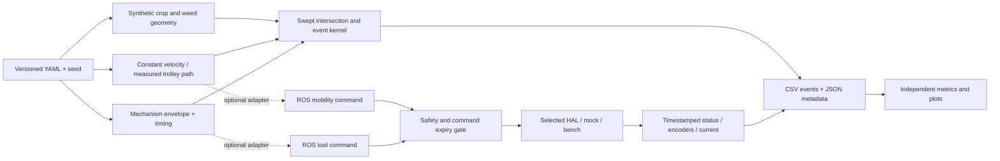

# Mechanics-first pivot architecture — proposed

Date: 2026-09-14. Phase 0 design, not implemented. Baseline findings: [current-state audit](current_state_audit.md). Product direction: affordable precision mechanical weed control for Indian small and organic farms. Primary question: can repeated cutting or shallow disturbance suppress weeds with useful throughput and extremely low crop damage?

Mechanics first → simple sensing → control → vision only if justified → autonomy last. Keep the repository and existing Jazzy baseline. A manually pushed trolley, rail or fixed simulated velocity is sufficient for the first experiments.

## Architecture decisions

| ADR | Decision and status | Consequence / revisit condition |
|---|---|---|
| 001 | Proposed: retain current ROS2 Jazzy and package names | No migration or mass move; validate in a clean matching environment when available |
| 002 | Proposed: standalone Python geometry/evaluation kernel before ROS/Webots integration | Seeded tests and experiments run without robot infrastructure; Webots later illustrates envelopes/trajectories |
| 003 | Proposed: interchangeable one-driven-axis tools on a common trolley fixture | Minimize cost and moving parts; add retractors only when geometry evidence demands them |
| 004 | Proposed: one final gated actuator authority, independent deadlines | No raw simulator bridge or second publisher may bypass stop/tool interlocks |
| 005 | Proposed: freeze YOLO, arm, coverage/autonomy expansion and chemical stream | Preserve files; reactivate only for a named failure of simpler crop protection |
| 006 | Proposed: separate simulated geometry from measured biology | No soil/root destruction claims from Webots; empirical response models require real datasets and held-out validation |

## Proposed boundaries and interfaces

- **Mobility:** accepts linear/angular velocity or measured trolley position; no field navigation required. Define wheel order FL, FR, RL, RR, signed encoder deltas, metres/seconds and actual sample intervals before reusing odometry/PID. Choose one command owner per mode and one odometry/TF authority.
- **Tool model:** dimensions, mounting transform, conservative active swept envelope, inactive body/guard envelope, onset delay, deactivation/coast-down and phase where needed. Tool depth/height constrain geometry only. A disk cannot model uprooting or severing probability.
- **Sensing:** timestamp, sequence, validity and frame; preserve raw simulator topics under a separate namespace from estimates. Initial “perfect crop centres” is an explicitly ideal scenario; add position uncertainty and dropped detections without requiring a camera.
- **Safety:** boot DISARMED; explicit arming with healthy inputs; READY/RUNNING/STOPPED/FAULT states; emergency/fault latch and deliberate reset/rearm. Keep existing SafetyCmd compatibility through an adapter until a versioned status message is justified. Sensor, motion, tool and transport deadlines are independent; a fresh heartbeat does not renew an old tool command. Use a monotonic deadline clock on a real bench and defined simulation time in tests.
- **Final gate/HAL:** every STOP/FAULT and every expiry actively sends all motion/tool outputs to neutral, without waiting for new commands. Driver failure revokes readiness and attempts stop; it never masquerades as a healthy mock in hardware mode. Distinguish command-off from verified coast-down. Default tool off whenever travel stops; any stationary-cut bench mode must be explicit, bounded and independently tested.
- **Feedback/evaluation:** append events with run ID, mechanism/config hash, source revision, seed, timestamp and evidence class. Record requested and actual actuator state separately. Existing ToolCmd fields are retained initially; a future internal adapter can use tool ID, enable/setpoint and valid-until without changing ROS messages during this audit. No sprayer driver or chemical behavior is proposed for implementation.

Do not reshuffle the repository now. Add `simulation/geometry`, `simulation/experiments`, `evaluation`, `configs` and `tests` when their work begins; retain current `deweeder_tertill` and root simulation assets. Add `mechanical/cadquery`, `mechanical/exports` and `mechanical/bom` during concept implementation, with parameterized scripts and STEP/STL exports. ROS remains an adapter rather than a dependency of the geometry kernel.

## First three mechanism concepts

All are **ESTIMATED** concepts with one driven tool axis, manual vertical adjustment, passive guarding and a common external trolley. Full BOM categories, maintenance, risks, dimensions and weighted matrix: [mechanism concept notes](mechanism_concept_notes.md).

| Concept | Working principle | Main advantage | Main uncertainty |
|---|---|---|---|
| A. Guarded rotating line | Replaceable trimmer line cuts above soil | Few parts and simple consumables | Flexible swept radius, wrapping, thrown debris and regrowth |
| B. Shallow rotating tines | Geared spindle disturbs a shallow soil layer | Replaceable low-complexity cartridge | Root-zone damage, stones, mud and unknown soil torque |
| C. Reciprocating mini-hoe | One motor/eccentric drives a short guided blade stroke | More bounded geometric envelope | Backlash, guide contamination, impact/stall and blade wear |

Use the requested weights: precision 25%, crop safety 25%, cost 15%, reliability 10%, serviceability 10%, speed 10%, energy 5%. Initial hypothesis scores are A 2.90, B 2.80, C 3.15 out of 5. They are not precise performance measurements: a one-point precision score change erases C's lead over A. **No winner selected.** Compare accessible geometry first, then build inactive dummy envelopes before powered prototypes. No purchases, manufacturing or price claims are part of Phase 0.

## Minimum simulation and first experiment

**Question:** does any simple fixed tool envelope preserve useful target exposure while avoiding crop/guard overlap under plausible path uncertainty? Test both inter-row and near-row trajectories; an easy inter-row result cannot establish intra-row weed control. Repeat passes later test geometry, not biological regrowth.

Use a 2.5 m observation segment with run-in/run-out, adjacent crop rows and fixed target-area boundaries. Coordinate system: x along travel, y lateral, z upward; internal units m, s, rad. Invented fixture baseline: 0.50 m row spacing, 0.30 m plant spacing, 25 mm crop radius and 80 mm swept width. These are synthetic engineering examples, not agronomic profiles or recommendations.

Required configuration names and semantics:

| Inputs | Contract |
|---|---|
| row_spacing, plant_spacing, plant_spacing_variance | Positive spacing in m; variance in m²; generate positive intervals with a documented truncated distribution and record actual statistics |
| crop_radius, crop_height | Positive m; crop centre and uncertainty distribution separate from envelope size |
| weed_density, weed_distribution, weed_radius | Density per m² of the declared target area; nonnegative; initially uniform Poisson and clustered option; positive radius |
| robot_lateral_error, robot_heading_error | Error model must state bias, standard deviation or bounded amplitude and along-pass correlation; m and rad |
| tool_width, tool_depth, tool_active_radius | m; define depth positive below soil; sign and envelope consistency rules depend on mechanism; above-soil line uses separate mounting height |
| tool_response_time, vehicle_speed | Nonnegative onset delay s; positive experiment travel m/s; stopped travel handled as explicit fault/edge case |
| Additional fields | mechanism, tool/guard transform, guard footprint, deactivation delay/coast-down, timing jitter, longitudinal position error, phase, seed, path offset, row length, observation limits and evidence class |

Reject nonfinite values, impossible mechanism geometry, negative density, invalid distributions and impossible spacing during configuration validation. Deliberate close/overlapping crops are explicit stress fixtures, not silently resampled away. High-density limits must fail clearly rather than truncate targets and inflate exposure.

1. **Deterministic fixtures:** no weeds, no crops, tangent/near-miss/contact, missing crop, close pair, overlapping weed/crop, tool off, delay/coast-down, and ±30 mm bounded lateral drift. Compare swept disk/rectangle intersections against analytic expected counts. Include body/guard contacts when the cutter is off.
2. **Small seeded pilot:** same fields and error realizations for all three mechanisms, equal swept widths and target areas. A/B full disks should yield identical geometric results under identical settings; a difference without differing envelopes is a defect. Store uncertainty assumptions rather than tune them to attractive results.
3. **Sweep after fixtures pass:** speed [0.1, 0.25, 0.5, 0.75, 1.0] m/s; lateral error [0, 5, 10, 20, 30, 50] mm; additional crop margin [20, 30, 40, 50, 75] mm. Define margins as surface-to-hazard clearance, not centre radius. Pilot uses a small declared count; final selected cells use 10,000 independent rows each. The full 150-cell grid at 10,000 rows is 1.5 million rows per mechanism, not 10,000 total.
4. **Timing extension:** onset/coast-down delay [0, 0.05, 0.10, 0.20] s as invented stress conditions, tool widths [0.04, 0.08, 0.12] m and spacing [0.20, 0.30, 0.40] m on shortlisted cases. At constant speed a fixed always-active envelope should be speed-invariant; speed becomes consequential through timing/phase, uncertain trajectory or dwell. Do not manufacture speed dependence.

Use continuous swept tests or prove timestep convergence with a geometric error bound. Keep row-level samples independent and bootstrap over rows (or another documented cluster-aware interval), not correlated plant events. Report per-crop intersection fraction and probability of at least one intersection in a row separately, with counts and 95% intervals. No zero-collision run proves zero risk.

**Outputs:** raw event CSV (timestamp, tool pose, vehicle pose, nearest signed crop/weed distance, command state, actual active state, intersection, exposure event and IDs), per-run counts CSV, immutable configuration/seed/source metadata JSON, and plots of crops/weeds, path, safe zones, active envelope, guard contacts, exposures and misses. Heatmaps are titled **SIMULATED crop-envelope intersection** and **SIMULATED weed exposure**, not crop damage or weed removal. Data must replay the same deterministic run.

**Decision gate:** reject dominated envelopes; identify the coverage versus clearance frontier. The user hypothesis >90% suppression and <2% damage cannot be accepted by geometry. As a provisional screening rule, inspect whether exposure exceeds 90% and the upper bound on crop-intersection fraction is below 2%, clearly labelled proxies. Failure narrows geometry/tool-width/path choices; passing advances to a bench hypothesis, not a product claim. Include weeds in protected crop zones in the original target denominator and separately show their unavoidable misses.

## Evaluation and empirical follow-up

Every record belongs to exactly one evidence class: SIMULATED, ESTIMATED, BENCH-MEASURED or FIELD-MEASURED. Mixed-input forecasts remain SIMULATED with provenance links to measurements; never relabel them as measured outcomes.

- WRE = unique successfully treated weeds / predefined target weeds. Specify immediate treatment and repeated-pass suppression separately, with follow-up time and success rubric.
- CDR = unique damaged crop plants / encountered crops, using a recorded injury rubric and delayed observations. MR = untreated targets / targets; 1-WRE only for exhaustive binary outcomes at the same assessment time.
- FTR = non-target/crop treatment events / total treatment events; deduplicate by event, not simulation timestep. Zero denominators are unavailable, not zero.
- Throughput = 60 × distance/elapsed seconds in m/min. Theoretical capacity = 0.36 × speed(m/s) × credited width(m) ha/h; effective capacity needs measured field efficiency, turns, stoppages and repeat-pass count. Acre/h = ha/h / 0.404686. Do not credit untreated width as controlled area.
- Wh/m = integral of voltage × current over time / 3600 / distance. Log tool and mobility separately. INR/m and INR/acre need dated labour, consumables, energy, maintenance and amortization assumptions; no current BOM pricing is established.
- Minimum safe weed-to-crop separation requires measured damage with an upper confidence bound below the agreed threshold. A simulated signed clearance is a separate geometric quantity.

Phase 4 later prepares a low-cost 2–3 m rail/trolley, adjustable height/depth, encoder/speed sensing, current/voltage logging, guarded tool, motor controller and independent emergency stop, with drawings, BOM, wiring concept, test procedure and safety checklist. Begin with dummy envelopes, then controlled powered soil-bin tests. No manufacturing is authorized by this document. Phase 5 fits removal/damage probabilities only after data exists, with soil condition, weed/crop size, speed, clearance, uncertainty and pass history. Split calibration/validation by trial or plot; flag extrapolation. A full digital twin or plant biology engine is unnecessary.

## Prioritized backlog and acceptance criteria

Order reflects risk; geometry-only work can proceed without powering hardware or waiting for a full rover repair.

| Priority | Owner / bounded task | Acceptance evidence / dependency |
|---|---|---|
| P0-1 | Robotics + QA: restore core syntax/imports and installed packaging | Behavior parses with reconciled safety semantics; no conflict text in active assets; driver packages and launch/config assets import from clean install; Jazzy colcon build/test when environment exists |
| P0-2 | Robotics + QA: one gated output path with immediate stop, independent expiry and explicit rearm | Recording mock proves all outputs neutralize on emergency, sensor/tool/motion timeout, transport loss, readiness loss and shutdown without another command; no automatic restart |
| P0-3 | Architect: lock units, topic ownership and hardware assumptions | One wheel order/geometry profile, raw/estimated topic separation, explicit tool interface and one command owner; review before connecting bench |
| P1-1 | Simulation + QA: configuration validator and deterministic swept-event kernel | Analytic boundary fixtures, impossible-input rejection, replay, body/guard contacts, timing/coast-down and no denominator loss; no ROS dependency |
| P1-2 | Evaluator: event metrics, exports and paired-seed pilot | Correct denominators/evidence classes, row-level intervals, visual overlays and speed-invariance check; depends on P1-1 |
| P1-3 | Simulation + evaluator: parameter sweeps and clearance frontier | Reproducible CSV/JSON and heatmaps with configuration/sample counts; no removal/damage claim; depends on pilot validation |
| P2-1 | Mechanical + evaluator: parameterized CAD for A/B/C and revised matrix | CadQuery scripts, STEP/STL, dimension definitions, comparable envelopes, BOM estimates with uncertainty; no winner based only on scores |
| P2-2 | Mechanical + robotics + QA: physical bench specification | Drawing/wiring/BOM/sensor/test package, depth limits, guards and independent stop design; P0 safety gate before powered integration |
| P3-1 | Robotics: repair odometry/PID and selected simulator adapter only where bench requires it | Known signed encoder trajectories, real output path, stopped-motion tool interlock, mock-only launch/rosbag replay, no feedback loop |
| P3-2 | Simulation: optional Webots digital bench visualization | Valid tool/path/body envelopes and consistent frames, agreement with geometry kernel; no soil destruction model |
| P4 | Agri-R&D: controlled repeated-pass measurements, then empirical models | Predeclared success/follow-up, crop injury, energy/wear/clogging, uncertainty and held-out trials; requires physical data |
| Deferred | Vision/arm/autonomy, spray implementation, broad rover refactor | Only reopen against a specific measured engineering deficit |

QA coverage must explicitly include missing crops, close crops, overlapping crop/weed geometry, high density, actuator delay/coast-down, sensor failure, motor stall, encoder error, lateral drift, emergency stop, excessive static tilt, stopped mobility with active tool, tool timeout and communication loss. Current repository tests do not cover this matrix. Geometry fixtures cover spatial cases; recording driver/node tests cover control faults; physical stop timing and injury require bench measurements.

## Team review gate

Architect defines a measurable question → mechanical/ROS/simulation owner implements a bounded task → evaluator reports assumptions, denominators and uncertainty → QA returns PASS/FAIL with artifacts → tech lead decides continue/revise/freeze. No self-reported accuracy or beautiful render is an acceptance test. First implementation deliverable is P1-1, the small deterministic geometry kernel; P0 repairs are the prerequisite for powered/control integration. This Phase 0 change deliberately ends at documentation.
